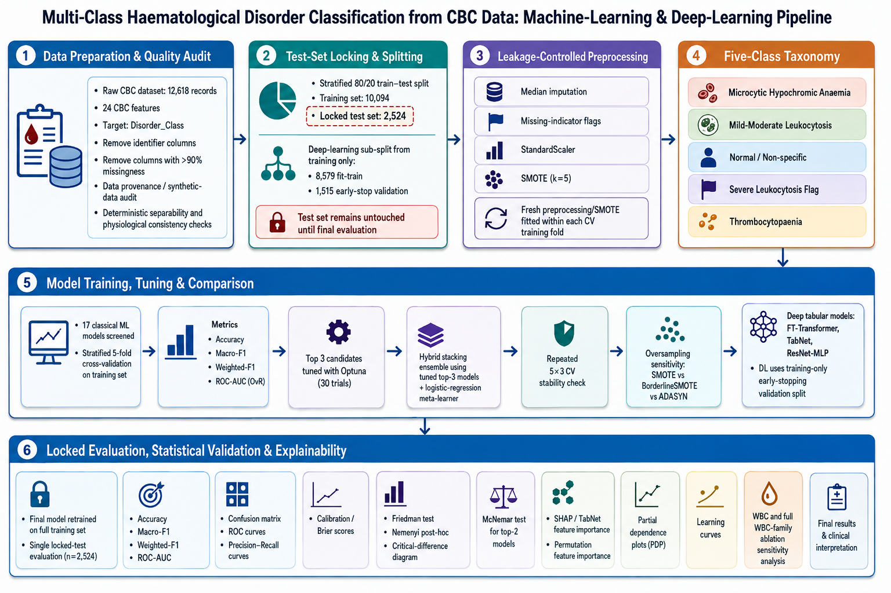
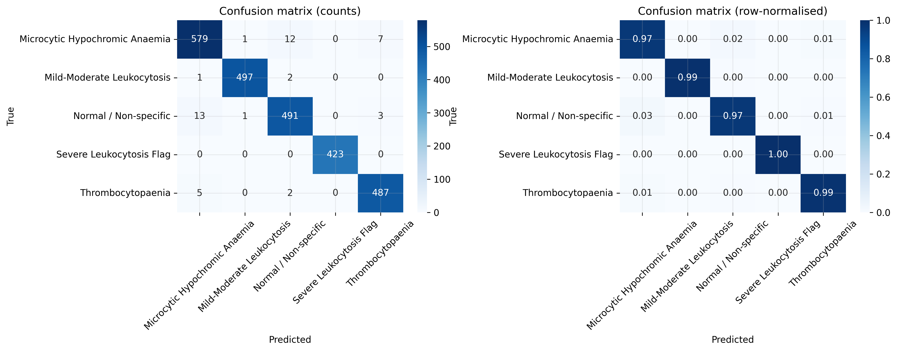
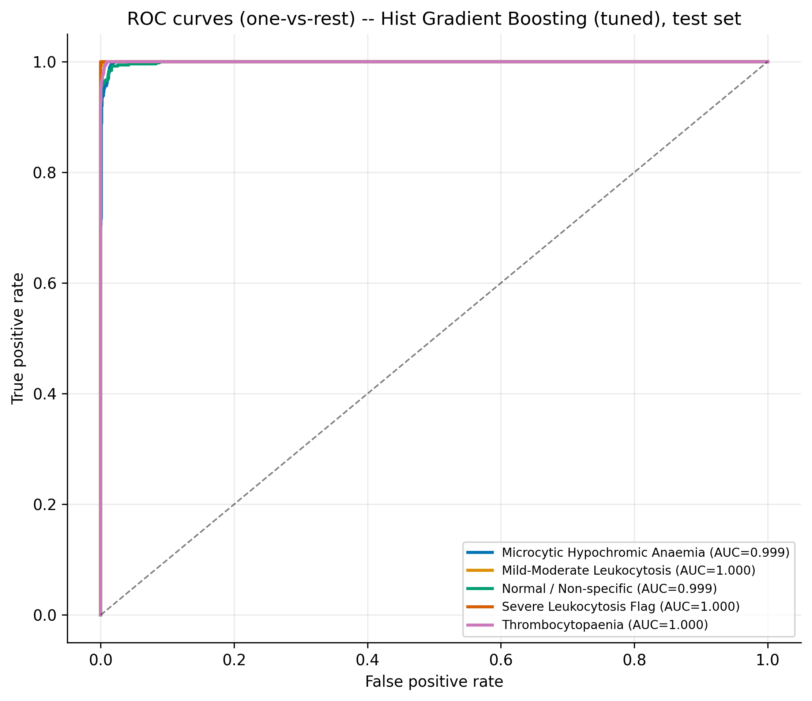
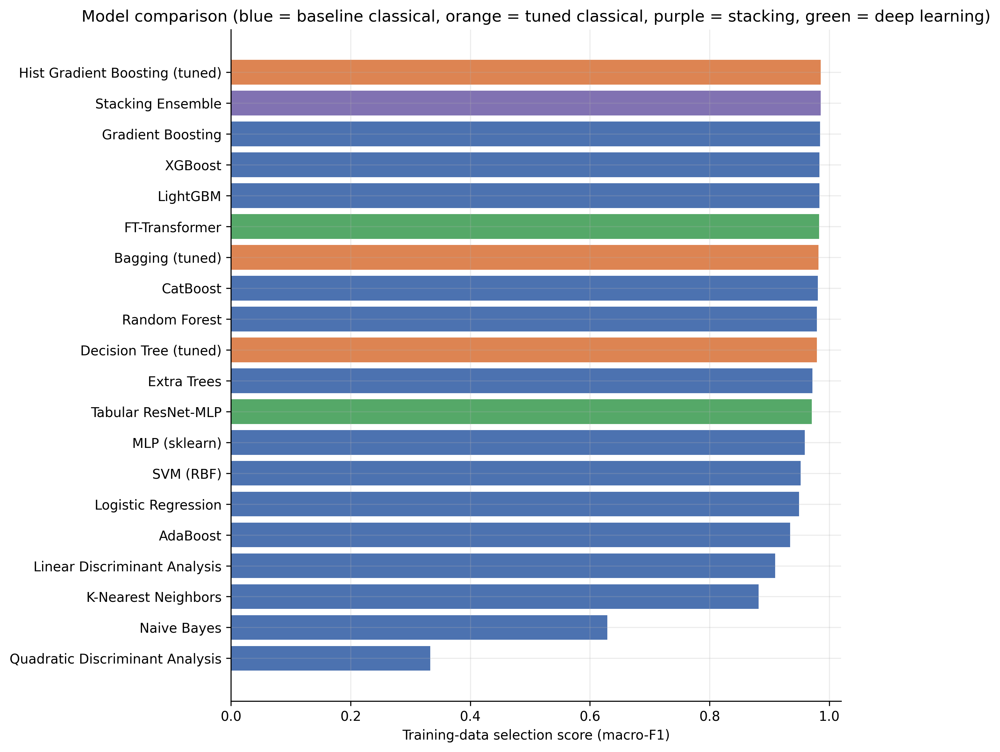

<div align="center">

# Multi-Class Haematological Pattern Classification from CBC Data

### A Leakage-Controlled, Reproducible Machine-Learning and Deep-Learning Benchmark

**12,618 records · 23 CBC features · 5 pattern categories · 17 classical models + deep tabular models**

Al Amin Remon · Mayen Uddin Mojumdar · Md. Sadekur Rahman — Department of Computer Science and Engineering, Daffodil International University

[**Dataset card**](docs/DATASET_CARD.md) · [**Validation protocol**](docs/VALIDATION_PROTOCOL.md) · [**Model methods**](docs/MODEL_METHODS.md) · [**Results**](docs/RESULTS.md) · [**Reproducibility map**](docs/REPRODUCIBILITY_MAP.md)

</div>

## Study overview



**Figure 1.** Study pipeline. The stratified 80/20 split is made first; the 2,524-record test set stays locked until the final evaluation. Imputation, scaling and SMOTE are fitted inside every training fold. Full-resolution file: [`figures/final/fig1_methodology_diagram.png`](figures/final/fig1_methodology_diagram.png).

> The class labels are CBC-pattern categories. Results describe how well these categories can be recovered from CBC parameters; they are **not** estimates of diagnostic accuracy in a clinical population. One class (*Severe Leukocytosis Flag*) is separable by WBC alone (single-feature AUC = 1.000), consistent with a threshold-based definition; see the audit (Table S6) and the WBC ablation (Table 5c).

## Headline results (locked test set, n = 2,524)

Selected model (chosen from training-data evidence only): **Hist Gradient Boosting (Optuna-tuned)**.

| Metric | Point estimate | 95% bootstrap CI |
|:--|--:|:--|
| Accuracy | 0.9814 | 0.9758 – 0.9865 |
| Macro-F1 | 0.9825 | 0.9774 – 0.9873 |
| ROC-AUC (one-vs-rest) | 0.9996 | 0.9994 – 0.9998 |

Training-CV macro-F1 of the selected model: 0.9859 ± 0.0030 (5-fold). Friedman test across 18 candidates: χ² = 81.88, p = 1.77 × 10⁻¹⁰. All tables are in [`results/`](results/), all figures in [`figures/final/`](figures/final/); see [docs/RESULTS.md](docs/RESULTS.md).

<table>
<tr>
<td width="33%"><br/><b>Confusion matrix</b></td>
<td width="33%"><br/><b>One-vs-rest ROC curves</b></td>
<td width="33%"><br/><b>Training-data leaderboard</b></td>
</tr>
</table>

## Repository structure

```text
cbc-12618-multiclass-benchmark/
├── data/
│   ├── hematology_cbc_dataset.csv      # 12,618 records, unmodified source file
│   ├── data_dictionary.csv             # Column definitions, units, missingness
│   └── README.md                       # Checksum and data notes
├── figures/
│   ├── final/                          # Methodology diagram + 9 generated figures (full resolution)
│   └── previews/                       # Downsized figure displayed in this README
├── src/cbcbench/                       # Installable package (refactored from the notebook)
│   ├── config.py  data.py  preprocessing.py
│   ├── audit.py   models.py  evaluation.py
│   ├── deep.py    stats.py   final_eval.py   outputs.py
├── scripts/                            # Numbered command-line pipeline (01-11) + release audit (12)
├── notebooks/                          # Original study notebook (source of truth, with outputs)
├── results/
│   ├── audit/                          # Tables 1, S2-S6   (data quality audit)
│   ├── model_selection/                # Tables 2, 2b-2d, 3, 4, 7, S7, best hyper-parameters
│   └── final_evaluation/               # Tables 5, 5b-5e, 6, 8, 10  (locked test set)
├── models/                             # Final fitted pipeline (joblib)
├── tests/                              # Dataset contract, protocol and committed-results tests
├── docs/                               # Dataset, methodology, results and governance documentation
├── requirements/                       # Core and full dependency sets
└── pyproject.toml                      # Installable Python package
```

## Installation

Python 3.11 – 3.13 recommended.

```bash
python -m venv .venv
source .venv/bin/activate            # Windows PowerShell: .\.venv\Scripts\Activate.ps1
python -m pip install -e '.[full,test]'
```

`pip install -e '.[test]'` is enough for the data checks, script 01 and the tests. The `full` extra adds LightGBM, XGBoost, CatBoost, Optuna, SHAP, statsmodels, scikit-posthocs, PyTorch and TabNet. See [requirements/README.md](requirements/README.md).

## Reproduce the study

### 1. Validate the data and the repository

```bash
python scripts/12_release_audit.py     # dataset SHA-256, shape, results inventory, file manifest
python -m pytest -q
```

### 2. Data-quality audit (seconds)

```bash
python scripts/01_data_audit.py --out outputs
```

### 3. Full pipeline (hours on CPU; every table and figure)

```bash
python scripts/11_run_all_pipeline.py --confirm-final-test --out outputs
python scripts/12_release_audit.py --compare outputs      # compare with the committed results/
```

or run the stages individually (each reads the cache written by the previous ones):

| Script | Notebook sections | Output |
|:--|:--|:--|
| `01_data_audit.py` | §1–2 | Tables 1, S2–S6 |
| `02_cv_model_screening.py` | §3–6 | Table 2 (17 models, 5-fold CV, training data) |
| `03_optuna_tuning.py` | §7 | `best_hyperparameters.json`, Table 2d |
| `04_stacking.py` | §8 | Table 2b |
| `05_training_sensitivity.py` | §9 | Tables 2c, S7 (+ isotonic-calibration check) |
| `06_deep_learning.py` | §10 | Table 3 |
| `07_statistical_comparison.py` | §11 | Table 7 (+ Nemenyi if scikit-posthocs is installed) |
| `08_model_selection.py` | §12, §21 | Table 4, leaderboard figure |
| `09_final_test_once.py` | §12–13, 16, 17, 19 | Tables 5, 5b, 5e, 6, 8; ROC/PR/calibration/confusion figures; model |
| `10_post_hoc_analyses.py` | §14, 15, 18, 20 | Tables 5c, 5d, 10; SHAP, permutation, learning-curve figures |

`--fast-debug` runs a reduced-scale smoke test (5 Optuna trials, 50 bootstraps, 3 DL epochs); it is **not** used for any reported number. Script `09` refuses to run without `--confirm-final-test`.

Scripts write to `outputs/` (git-ignored). The committed copies in `results/`, `figures/final/` and `models/` are the outputs of the original study run (Kaggle, Python 3.13.16, CUDA GPU). Tuning, deep-learning training and GPU kernels can differ slightly across hardware and library versions, so regenerated values may differ in the last decimals; `12_release_audit.py --compare` reports the differences.

### 4. Notebook

[`notebooks/01_hematology_scientific_report.ipynb`](notebooks/01_hematology_scientific_report.ipynb) is the original end-to-end study notebook with its stored outputs. It finds the dataset at `data/hematology_cbc_dataset.csv` and writes to `results/notebook_run/` (git-ignored), so re-running it never overwrites the committed results.

## Evaluation protocol in brief

1. Stratified 80/20 split (`seed=42`) on the raw data → 10,094 training / 2,524 test records.
2. Median imputation with missing-indicator flags, `StandardScaler` and SMOTE (k = 5) are fitted **inside each training fold** via an `imblearn` pipeline.
3. 17 classical models screened by stratified 5-fold CV on the training split; three algorithmically diverse candidates tuned with Optuna (30 trials each, macro-F1).
4. Stacking ensemble (logistic-regression meta-learner), repeated 5×3 CV, FT-Transformer / residual-MLP (and TabNet when installed) on an 8,579 / 1,515 training sub-split.
5. Friedman test for model comparison; final model chosen on training evidence only (parsimony rule if the stack is not distinguishable from its best single model).
6. One locked test-set evaluation with bootstrap CIs, calibration, McNemar test, WBC-family ablation, permutation importance and SHAP.

## Scope notes

* The committed results come from a run where `pytorch-tabnet` and `scikit-posthocs` were **not installed**: TabNet is therefore absent from Table 3/4, and the Nemenyi post-hoc outputs (Tables 7b/7c, heat-map, critical-difference diagram) were not produced. Installing them (`requirements/full.txt`) and re-running scripts 06–08 generates these outputs.
* The BorderlineSMOTE / ADASYN comparison and partial-dependence plots shown in Figure 1 are not part of the study notebook and are not included in this repository's results (the notebook mentions the oversampling variants as preliminary work giving cross-validated macro-F1 within 0.001 of SMOTE).

## Citation, ethics and licence

Fill in before release: ethics-committee name/approval number, repository DOI, licence (see the end-matter checklist at the end of the notebook). No licence file is included until the authors choose one.

## Data stewardship

See [docs/DATA_GOVERNANCE.md](docs/DATA_GOVERNANCE.md) and [SECURITY.md](SECURITY.md).
